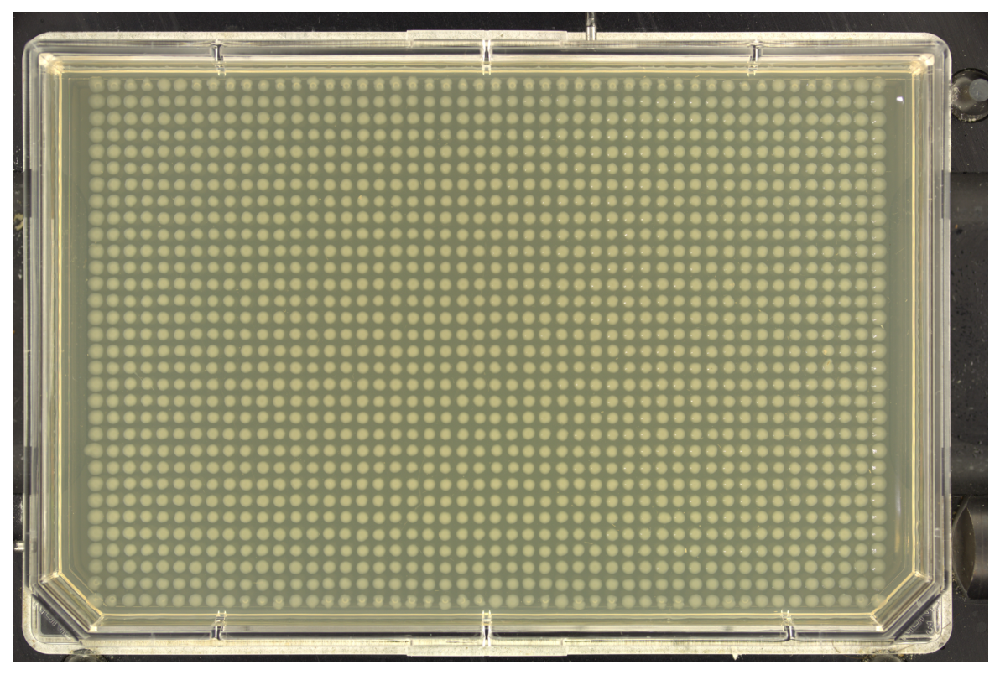
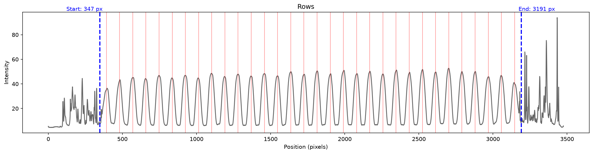
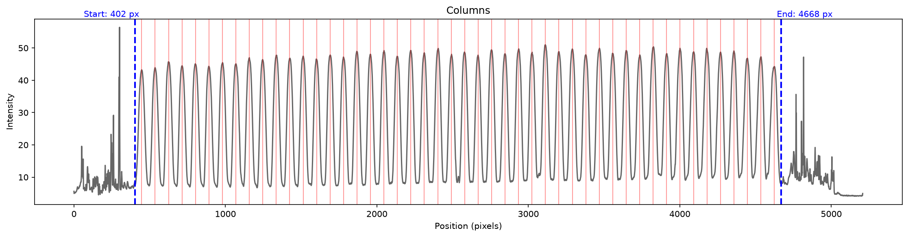
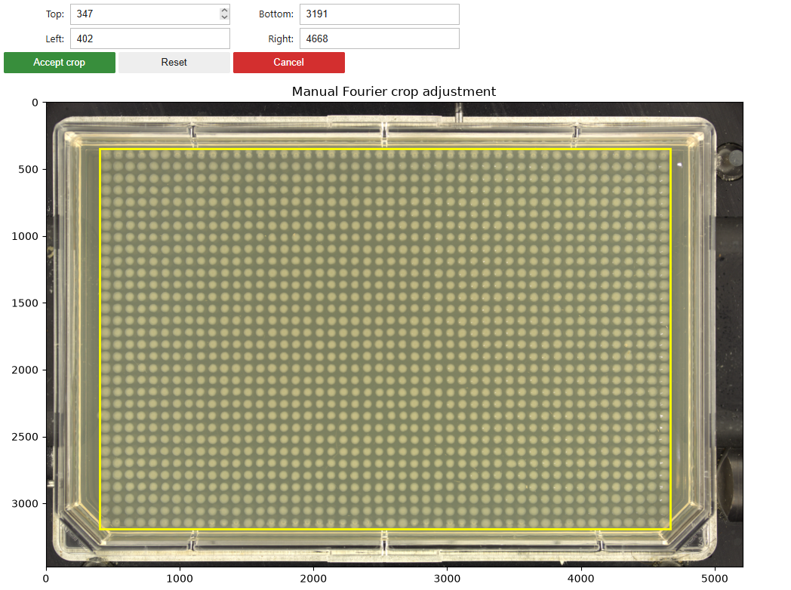
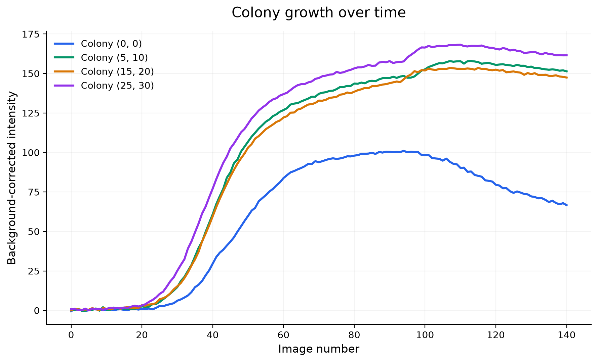

Example
=======

This example demonstrates how to load an image time series, detect and crop a colony grid, and calculate colony intensities.

Importing libraries
-------------------

.. code-block:: python

   from pathlib import Path
   import matplotlib.pyplot as plt
   from colonyscopy import Plate, Image_cropping
   from colonyscopy.tools import load_images

Loading input images
--------------------

Provide the image paths in chronological order.

.. code-block:: python

   paths = sorted(Path("path/to/images").glob("*.jpg"))
   images = load_images(paths)

Automatic cropping
------------------

Specify the expected number of colony rows and columns, and use the first image as the reference background. Fourier analysis is used to detect the colony grid and determine the cropping boundaries.

.. code-block:: python

   layout = (32, 48)
   initial_plate = Plate(images, layout=layout, bg=images[0])

   cropper = Image_cropping(initial_plate)
   cropped_images = cropper.auto_crop_fourier(plot=True)

If the automatic quality assessment passes, the crop is accepted automatically. Otherwise, manual inspection is requested.

Manual cropping (optional)
--------------------------

If the proposed cropping boundaries require adjustment, they can be modified interactively using Jupyter widgets:

.. code-block:: python

   cropper.adjust_fourier_crop()

After accepting the adjusted boundaries, the cropped images are available through ``cropper.cropped_image``.

Colony analysis
---------------

After the cropping boundaries have been accepted, create a new plate from the cropped images. 
Before accessing individual colonies, a speckle mask must be created explicitly using :meth:`create_speckle_mask()`. 
Once the mask has been created, individual colonies can be initialized using :meth:`create_colonies()`.

.. code-block:: python

   plate = Plate(cropped_images, layout=layout, bg=cropped_images[0])

   plate.create_speckle_mask()
   plate.create_colonies()

   colony = plate.colonies[0, 0]
   intensity = colony.colony_intensity

Growth curves from multiple colonies can be compared to visualize differences in colony development over time.

.. code-block:: python

   for colony in plate.all_colonies():
       colony.create_colony_intensity()

   selected_colonies = [(0, 0), (5, 10), (15, 20), (25, 30)]

   fig, ax = plt.subplots(figsize=(9, 5.5))

   for row, col in selected_colonies:
       colony = plate.colonies[row, col]
       ax.plot(
           colony.colony_intensity,
           label=f"Colony ({row}, {col})",
           linewidth=2
       )

   ax.set_xlabel("Image number")
   ax.set_ylabel("Colony intensity")
   ax.set_title("Colony growth over time")

   ax.grid(True, alpha=0.15)
   ax.spines["top"].set_visible(False)
   ax.spines["right"].set_visible(False)
   ax.legend(frameon=False)

   fig.tight_layout()
   plt.show()

